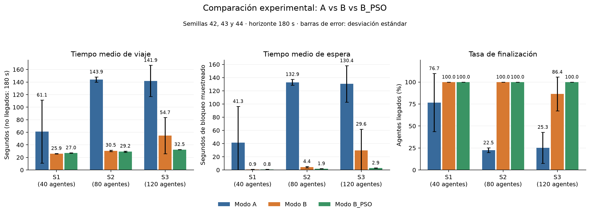

# Simulación de multitudes e inteligencia artificial

Proyecto académico de la **Universidad Mayor de San Simón (UMSS)** para la materia **Inteligencia Artificial** (Gestión II/2026).  
Docente: **Lic. Patricia Rodríguez Bilbao** | **Grupo 13**

Este proyecto implementa un prototipo 2D de evacuación peatonal basado en física de fuerzas sociales, detección no supervisada de cuellos de botella con **DBSCAN** optimizado ($kd$-tree), diagnóstico de persistencia temporal en cuadrícula espacial ($2 \times 2\text{ m}$), planificación adaptativa de rutas con **$A^*$** y calibración metaheurística mediante **Optimización por Enjambre de Partículas (PSO)**.

El sistema compara tres modos de navegación:
* **Modo A (Ruta fija más corta):** Búsqueda geométrica sin percepción de congestión. En escenarios densos colapsa por formación de arcos de compresión (*arching effect* de Helbing).
* **Modo B (Adaptativo estándar):** Replanificación dinámica mediante $A^*$ con matriz de costo $D(z, t)$ entregada por el diagnóstico espacial.
* **Modo B+PSO (Adaptativo calibrado con IA):** Navegación adaptativa optimizada con los hiperparámetros calibrados por PSO ($\theta^* = [\alpha=2.984,\ k_s=2.000,\ k_r=0.977]$), que redistribuye el flujo oportunamente hacia vías alternativas y resuelve completamente el cuello de botella.

---

## Módulos y responsables

| Módulo | Archivo | Responsable | Función principal |
|---|---|---|---|
| **Entorno** | `modulos/entorno.py` | Padilla Alexander | Geometría del recinto ($30 \times 20\text{ m}$), matriz de obstáculos y conectividad |
| **Agentes** | `modulos/agentes.py` | Bustamante Escobar Jhosselin Sthaicy | Motor físico continuo ($\Delta t = 0.1\text{ s}$) y Fuerzas Sociales de Helbing |
| **Visualización Pygame** | `modulos/visualizacion.py` | Choque Aguilar Wendy | Renderizado nativo en Pygame con mapa de calor y estados |
| **Servidor e Interfaz Web** | `modulos/servidor_web.py` + `web/` | Alba Zapata Cristhian | Servidor HTTP local desacoplado e interfaz interactiva con controles en caliente |
| **Telemetría** | `modulos/telemetria.py` | Flores Choquetopa Nicole Marisol | Muestreo a $1.0\text{ s}$, registro CSV individual, cálculo de bloqueos y métricas |
| **DBSCAN** | `modulos/dbscan_deteccion.py` | Flores Mamani Daniel Teodoro | Agrupamiento espacial optimizado ($kd$-tree, $< 2\text{ ms}$), clasificación núcleo/frontera/ruido y métricas Silhouette / Davies-Bouldin |
| **Diagnóstico** | `modulos/diagnostico.py` | Lora Quilla Santiago Leonardo | Cuadrícula de $2 \times 2\text{ m}$, persistencia temporal ($3.0\text{ s}$) y matriz de costo $D$ |
| **Navegación $A^*$** | `modulos/navegacion_astar.py` | Orellana Castro Keyla Yhajaira | Rutas iniciales y actualización dinámica con reglas anti-oscilación ($\tau$, margen) |
| **Optimización PSO** | `modulos/optimizacion_pso.py` | Orellana Castro Keyla / Padilla Alexander | Calibración metaheurística sobre episodios completos con función multiobjetivo $J(\theta)$ |

---

## Arquitectura y flujo de datos

```text
Entorno -> MotorAgentes (0,1 s) -> Telemetria (1,0 s)
                                   |                 |
                                   v                 v
                                 DBSCAN      DiagnosticoCongestion
                             grupos y ruido          |
                                                     D
                                                     v
                  siguiente tick <---------- NavegadorAdaptativo A*
                                                     ^
                                                     |
                                   capturas/theta_optimo.json (B+PSO)

Visualización (Doble interfaz):
  - Web interactiva: http://127.0.0.1:8000 (modulos/servidor_web.py + web/)
  - Pygame nativo: main.py --visualizar
```

1. **Entorno:** Representa el recinto de $30 \times 20\text{ m}$ mediante una cuadrícula de $1 \times 1\text{ m}$ leída de `configuracion.json`. Entrada en $(1, 11)$, salida en $(29, 11)$ y barrera central en $x=15\text{ m}$ con paso principal ($2\text{ m}$) y paso alternativo ($3\text{ m}$).
2. **MotorAgentes:** Genera poblaciones reproducibles de 40 (S1), 80 (S2) o 120 (S3) agentes con radio de $0.25\text{ m}$. Integra fuerzas sociales y restricciones geométricas en tiempo continuo ($\Delta t = 0.1\text{ s}$).
3. **Telemetria:** Cada segundo simulado ($1.0\text{ s}$) registra posiciones, velocidades, distancias entre vecinos y tiempos de bloqueo en arreglos NumPy `(N_activos, 2)`.
4. **DBSCAN:** Identifica clústeres espaciales densos ($\varepsilon = 1.2\text{ m}$, $\text{min\_samples} = 5$) mediante búsqueda indexada ($kd$-tree) en $< 0.7\text{ ms}$, clasificando puntos en núcleo, frontera y ruido.
5. **DiagnosticoCongestion:** Evalúa densidad y velocidad en celdas de $2 \times 2\text{ m}$, aplicando una regla de persistencia de $3.0\text{ s}$ para confirmar congestión crítica y construir la matriz de costo normalizada $D(z, t) \in [0, 1]$.
6. **NavegadorAdaptativo:** Modula el costo de las aristas en $A^*$ según $c(u, v) = L(u, v) \cdot (1 + \alpha \cdot D)$. Aplica reglas anti-oscilación ($\tau = 4.0\text{ s}$, margen mínimo $10\,\%$). En modo **B+PSO**, utiliza el vector óptimo $\theta^* = (\alpha=2.984, k_s=2.000, k_r=0.977)$ para anticipar el desvío hacia la ruta alternativa.

---

## Estructura del repositorio

```text
.
├── README.md                     # Documentación principal actualizada V3
├── demo_final.py                 # Demostración interactiva en un solo comando
├── main.py                       # CLI, experimentos por lotes e integración
├── configuracion.json            # Geometría y obstáculos del recinto
├── requirements.txt              # Dependencias (numpy, scikit-learn, matplotlib, pygame-ce)
├── AGENTS.md                     # Reglas de colaboración y contratos técnicos
├── modulos/                      # Los componentes del sistema y __init__.py
│   ├── entorno.py
│   ├── agentes.py
│   ├── visualizacion.py
│   ├── servidor_web.py          # Servidor HTTP local desacoplado
│   ├── telemetria.py
│   ├── dbscan_deteccion.py       # DBSCAN optimizado con kd-tree
│   ├── diagnostico.py
│   ├── navegacion_astar.py
│   └── optimizacion_pso.py       # Optimizador PSO multiobjetivo
├── web/                          # Interfaz web interactiva moderna
│   ├── index.html
│   ├── estilos.css
│   ├── app.js
│   └── tema.js
├── pruebas/                      # 13 suites de pruebas automatizadas
│   ├── ejecutar_todas.py         # Ejecutor maestro de la suite completa
│   ├── pruebas_dbscan.py         # Pruebas de kd-tree y métricas
│   ├── pruebas_pso.py            # Pruebas de convergencia y costo J
│   └── pruebas_interfaz_web.py   # Pruebas del servidor y API web
├── capturas/
│   ├── theta_optimo.json         # Vector óptimo calibrado por PSO
│   ├── v3/                       # Resultados oficiales de la batería V3 (27 episodios)
│   │   ├── tabla_comparativa_v3.csv
│   │   ├── comparacion_experimental_v3.png
│   │   └── resultados_experimentos_v3.csv
│   └── ...                       # Gráficos analíticos, CSVs y figuras de DBSCAN
├── scripts_analisis/             # Scripts de calibración, figuras y generación
│   └── calibrar_pso.py           # Calibrador metaheurístico multiobjetivo
└── informe/                      # Documentación académica final (Word y LaTeX)
    ├── 2do_Parcial_IA_Final.tex  # Código fuente LaTeX completo y verificado
    ├── figuras_latex/            # Figuras en alta resolución para LaTeX
    └── 2do PArcial IA Final.docx # Informe en formato Word (APA 7)
```

---

## Instalación y preparación

El proyecto utiliza Python 3 (verificado en **Python 3.10** hasta **Python 3.14**).

### 1. Clonar o descargar el repositorio y abrir terminal en la raíz:
```bash
cd simulacion-multitudes-ia
```

### 2. Crear y activar el entorno virtual:
* **Windows (PowerShell):**
  ```powershell
  python -m venv .venv
  .\.venv\Scripts\Activate.ps1
  python -m pip install -r requirements.txt
  ```
* **Linux / macOS:**
  ```bash
  python3 -m venv .venv
  source .venv/bin/activate
  python -m pip install -r requirements.txt
  ```

---

## Modos de ejecución

### 1. Demostración final recomendada (un solo comando)
Abre automáticamente la interfaz web interactiva en el navegador predeterminado y verifica la integridad de archivos:
```bash
python demo_final.py
```
* Para ejecutar previamente la suite completa de 13 pruebas automatizadas:
  ```bash
  python demo_final.py --con-pruebas
  ```
* Para verificar dependencias y archivos sin levantar ventana:
  ```bash
  python demo_final.py --solo-verificar
  ```

### 2. Interfaz web interactiva con controles en caliente
Inicia la simulación con el servidor web local (`http://127.0.0.1:8000`), permitiendo cambiar de escenario, modo y capas sin reiniciar la consola:
```bash
python main.py --interfaz --modo B_PSO --agentes 120 --semilla 43
```

#### Controles y atajos de teclado en la interfaz web:
| Control | Atajo | Acción en la simulación |
|---|:---:|---|
| **Modo** | `1` / `2` / `3` | Alterna entre **A** (fijo), **B** (adaptativo) y **B+PSO** (optimizado) |
| **Escenario** | `4` / `5` / `6` | Selecciona carga poblacional: **S1** (40), **S2** (80) o **S3** (120 agentes) |
| **Semilla** | `7` / `8` / `9` | Cambia la disposición inicial reproducible (**42**, **43**, **44**) |
| **Reproducción** | `Espacio` | Alterna entre Iniciar y Pausa en tiempo real |
| **Paso a paso** | `P` | Avanza un único tick físico de $\Delta t = 0.1\text{ s}$ |
| **Reiniciar** | `R` | Devuelve el episodio al instante $t = 0.0\text{ s}$ en pausa |
| **Velocidad** | `V` | Alterna velocidad de reproducción: $\times 1$, $\times 2$, $\times 4$ |
| **Capa Calor** | `H` | Muestra u oculta el mapa de calor de densidad local ($\text{agentes/m}^2$) |
| **Capa Grupos** | `C` | Visualiza los clústeres DBSCAN con distinción de núcleos, fronteras y ruido |
| **Capa Rutas** | `L` | Dibuja las trayectorias $A^*$ proyectadas por cada agente |
| **Captura** | `S` | Exporta captura instantánea en PNG |
| **Tema** | `T` | Alterna contraste visual entre Tema Oscuro y Tema Claro |
| **Ayuda** | `?` | Muestra la tarjeta informativa con todos los atajos |

---

### 3. Simulación con ventana nativa Pygame
```bash
python main.py --modo B_PSO --agentes 120 --semilla 43 --visualizar
```
* Teclas activas en Pygame: `H` (conmutar mapa de calor), `S` (guardar captura PNG), `Esc` (cerrar).

---

### 4. Batería experimental completa V3 (27 episodios)
Ejecuta la matriz experimental completa (**3 escenarios $\times$ 3 modos $\times$ 3 semillas = 27 episodios**) de forma desatendida y genera las estadísticas consolidadas:
```bash
python main.py --experimentos-v3
```
* **Salidas generadas:**
  * `capturas/v3/tabla_comparativa_v3.csv` (Tabla estadística resumen con medias y dispersión).
  * `capturas/v3/comparacion_experimental_v3.png` (Gráfica comparativa de barras en alta resolución).
  * `capturas/v3/resultados_experimentos_v3.csv` (Registro detallado por corrida).

* *Nota:* Para reproducir la batería base histórica de 18 episodios (únicamente modos A y B):
  ```bash
  python main.py --experimentos
  ```

---

## Resultados experimentales oficiales (Batería V3)

Resultados medios obtenidos sobre 27 episodios completos con horizonte de $180\text{ s}$ (semillas 42, 43 y 44). Fuente: `capturas/v3/tabla_comparativa_v3.csv`.

| Escenario | Agentes | Modo de Navegación | Tiempo de Viaje Penalizado (s) | Tiempo de Espera Medio (s) | Tasa de Finalización (%) | Solapamientos por corrida | Celdas Críticas Máximas | Cambios de Ruta Promedio |
| :---: | :---: | :---: | :---: | :---: | :---: | :---: | :---: | :---: |
| **S1** | 40 | **A** | 61.08 | 41.34 | 76.67 % | 0.00 | 0.33 | 0.00 |
| **S1** | 40 | **B** | 25.92 | 0.89 | 100.00 % | 0.00 | 0.00 | 110.33 |
| **S1** | 40 | **B+PSO** | **27.01** | **0.81** | **100.00 %** | **0.00** | **0.00** | **140.00** |
| **S2** | 80 | **A** | 143.94 | 132.85 | 22.50 % | 0.00 | 5.67 | 0.00 |
| **S2** | 80 | **B** | 30.52 | 4.35 | 100.00 % | 0.00 | 1.00 | 343.67 |
| **S2** | 80 | **B+PSO** | **29.20** | **1.93** | **100.00 %** | **0.00** | **0.33** | **361.67** |
| **S3** | 120 | **A** | 141.89 | 130.44 | 25.28 % | 0.00 | 8.67 | 0.00 |
| **S3** | 120 | **B** | 54.66 | 29.56 | 86.39 % | 0.00 | 3.33 | 566.67 |
| **S3** | 120 | **B+PSO** | **32.46** | **2.90** | **100.00 %** | **0.00** | **0.00** | **657.00** |



### Conclusiones del análisis experimental:
1. **Colapso del Modo A:** En alta densidad (S3), el modo estático sin IA sufre el efecto de arco de Helbing frente al embudo de $2\text{ m}$; solo el 25.28 % de los agentes logra evacuar y el tiempo de espera se dispara a $130.4\text{ s}$.
2. **Mitigación parcial del Modo B:** El modo adaptativo estándar alivia la congestión elevando la finalización al 86.39 %, pero en condiciones desfavorables (semilla 43) deja a 49 agentes bloqueados.
3. **Resolución total con Modo B+PSO:** Con los hiperparámetros calibrados por PSO ($\alpha^* = 2.984, k_s^* = 2.000, k_r^* = 0.977$), la masa de agentes anticipa la saturación y se bifurca oportunamente hacia el paso alternativo:
   * **100.00 % de evacuación exitosa** en todos los escenarios y semillas (120 de 120 agentes).
   * **Reducción del 90.2 % en tiempo de espera** respecto a B (de $29.56\text{ s}$ a $2.90\text{ s}$) y del **97.8 % respecto a A**.
   * **Cero celdas críticas persistentes** ($0.00$).

---

## Verificación y pruebas automatizadas

El repositorio cuenta con **13 suites de pruebas automatizadas** que validan la matemática, contratos de datos, algoritmos y estabilidad del sistema:

```bash
python pruebas/ejecutar_todas.py
```

* **Resultado esperado:** `SUITE COMPLETA: 13/13 scripts correctos.`

### Desglose de suites ejecutadas:
1. `pruebas/prueba_compatibilidad_astar.py`: Dimensiones, celdas y conectividad geométrica.
2. `pruebas/prueba_dos_rutas.py`: Transitabilidad independiente del paso principal y secundario.
3. `pruebas/pruebas_agentes.py`: Modelo de fuerzas sociales, no penetración de paredes y radio.
4. `pruebas/pruebas_diagnostico.py`: Discretización en celdas de $2\times 2\text{ m}$, persistencia temporal y matriz $D$.
5. `pruebas/pruebas_entorno.py`: Métodos de consulta espacial y mutabilidad controlada de mapa.
6. `pruebas/pruebas_integracion.py`: Cadencia temporal, sincronización de relojes y opciones CLI.
7. `pruebas/pruebas_navegacion.py`: Búsqueda $A^*$, costo adaptativo y reglas anti-oscilación.
8. `pruebas/pruebas_telemetria.py`: Contratos de salida NumPy `(N_activos, 2)` y CSV individual.
9. `pruebas/pruebas_visualizacion.py`: Renderizado base y reloj visual.
10. `pruebas/pruebas_visualizacion_integrada.py`: Integración del motor con la vista Pygame.
11. `pruebas/pruebas_dbscan.py`: Búsqueda espacial optimizada con $kd$-tree ($< 2.0\text{ ms}$), clasificación núcleo/frontera/ruido y métricas de agrupamiento.
12. `pruebas/pruebas_pso.py`: Función de costo $J$, límites factibles, reproducibilidad y convergencia metaheurística.
13. `pruebas/pruebas_interfaz_web.py`: Endpoints HTTP, concurrencia, carga de $\theta^*$ y API de control en caliente.

---

## Calibración metaheurística de PSO

Para reproducir el proceso de calibración de hiperparámetros que generó `capturas/theta_optimo.json`:
```bash
python -m scripts_analisis.calibrar_pso
```
* **Parámetros optimizados:** $\theta = (\alpha, k_s, k_r)$.
  * $\alpha \in [0.0, 5.0]$: Sensibilidad de evasión de congestión en $A^*$.
  * $k_s \in [0.5, 2.0]$: Fuerza interpersonal de separación física.
  * $k_r \in [0.5, 3.0]$: Fuerza de repulsión contra paredes y esquinas.
* **Solución óptima obtenida:** $\alpha^* = 2.984$, $k_s^* = 2.000$, $k_r^* = 0.977$.
