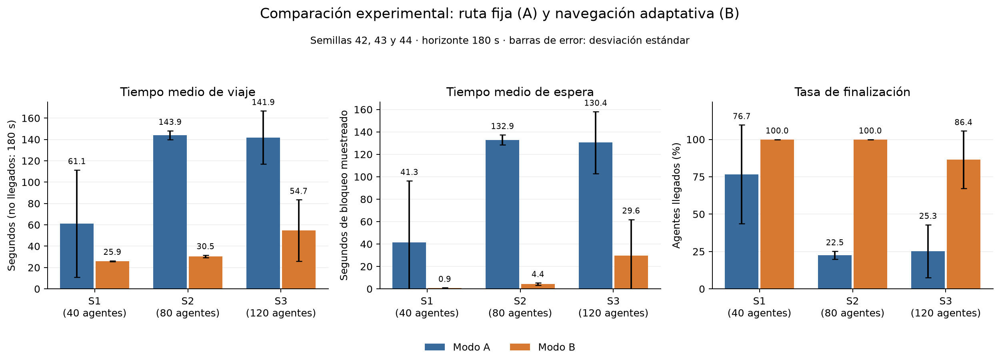

# Simulación de multitudes e inteligencia artificial

Proyecto académico de la **Universidad Mayor de San Simón (UMSS)** para la materia **Inteligencia Artificial**. Implementa un recinto 2D con movimiento por fuerzas sociales, detección no supervisada de grupos mediante DBSCAN, diagnóstico de congestión y navegación A* fija o adaptativa.

El objetivo es comparar cómo cambia el flujo al mantener la ruta más corta (**modo A**) o permitir rutas que eviten zonas densas (**modo B**). Los parámetros son iniciales y el prototipo no constituye una simulación peatonal validada con datos reales.

## Módulos y responsables

| Módulo | Archivo | Responsable | Función |
|---|---|---|---|
| Entorno | `modulos/entorno.py` | Padilla Alexander, según la guía del componente | Geometría, obstáculos y consultas espaciales |
| Agentes | `modulos/agentes.py` | Bustamante Escobar Jhosselin Sthaicy | Generación reproducible y motor de movimiento |
| Visualización | `modulos/visualizacion.py` | Choque Aguilar Wendy | Ventana Pygame, agentes, calor y contadores |
| Telemetría | `modulos/telemetria.py` | Flores Choquetopa Nicole | Registro CSV, bloqueo y métricas del episodio |
| DBSCAN | `modulos/dbscan_deteccion.py` | Flores Mamani Daniel | Grupos, ruido y calibración espacial |
| Diagnóstico | `modulos/diagnostico.py` | Lora Quilla Santiago Leonardo | Densidad, velocidad, persistencia y matriz D |
| Navegación A* | `modulos/navegacion_astar.py` | Orellana Castro Keyla | Rutas iniciales y actualización adaptativa |
| Optimización PSO | `modulos/optimizacion_pso.py` | Orellana Castro Keyla | Optimizador y costo J; calibración completa pendiente |

La integración, telemetría y consolidación documental están a cargo de Nicole. El [reparto histórico](docs/contexto/reparto_tareas.md) asigna inicialmente Entorno a Cristhian Alba Zapata; la atribución de la tabla para el código entregado conserva la indicada en `LEEME.txt`. Los documentos históricos se mantienen como contexto y no sustituyen las firmas reales del código.

## Arquitectura y flujo de datos

1. **Entorno:** lee `configuracion.json`. El mapa tiene 20 filas y 30 columnas; `0` indica libre y `1` obstáculo.
2. **MotorAgentes:** genera 40, 80 o 120 agentes con semilla explícita. Integra fuerzas y restricciones geométricas con **Δt = 0,1 s**, conservando los objetos llegados para el registro.
3. **Telemetria:** cada diez ticks (**1,0 s**) recibe la lista completa, reconoce llegadas y exporta solo los activos. Entrega posiciones NumPy `(N_activos, 2)`.
4. **DBSCAN:** analiza esas posiciones con `eps=1.2 m` y `min_samples=5`, produciendo etiquetas, tamaños y centroides de grupos.
5. **DiagnosticoCongestion:** en la misma muestra analiza directamente los agentes activos, calcula densidad y rapidez por celda de 2 × 2 m y exige 3 s de persistencia para confirmar una zona crítica. Produce `D` de forma `(10, 15)`.
6. **NavegadorAdaptativo:** en modo B recibe `D`, aplica A* con `alpha=2.0`, intervalo mínimo `tau=4.0 s` y mejora mínima del 10 %. La ruta aceptada se consume en el siguiente tick. En A se conserva la ruta inicial.
7. **Visualizacion:** si se habilita, dibuja en cada tick con `diagnostico.densidad`, el tiempo del motor y los contadores. Limita la presentación a 10 cuadros/s, conservando el paso físico fijo.
8. **PSO:** es una herramienta aparte para calibración por lotes; no se ejecuta dentro del tick ni ha calibrado los parámetros de la batería publicada.

```text
Entorno -> MotorAgentes (0,1 s) -> Telemetria (1,0 s)
                                   |                 |
                                   v                 v
                                 DBSCAN      DiagnosticoCongestion
                             grupos y ruido          |
                                                     D
                                                     v
                  siguiente tick <---------- NavegadorAdaptativo A*

Visualizacion Pygame <- agentes + tiempo + diagnostico.densidad
PSO (pendiente de conectar a episodios) <- métricas agregadas de Telemetria
```

DBSCAN aporta evidencia estructural de agrupamientos y ruido; sus etiquetas **no son la entrada de las reglas del diagnóstico actual**. La realimentación de A* utiliza `D`. La vista necesita densidad en personas/m², no la matriz normalizada `D` ni los estados de cadenas.

### Coordenadas y escenario

- Recinto: **30 × 20 m**. Entrada `(1, 11)`, salida `(29, 11)`.
- Barrera central en la columna 15, con paso principal de 2 m y alternativo de 3 m.
- Coordenadas físicas `(x, y)`, origen inferior izquierdo; índices `mapa[fila, columna]`.
- Radio habitual: 0,25 m; velocidad deseada uniforme entre 0,9 y 1,5 m/s.
- Las rutas son listas de waypoints `(x, y)` en metros, centrados en celdas.
- El motor asigna rutas A* fijas a agentes sin ruta. Para modo B, `main.py` crea y conserva el navegador adaptativo antes de construir el motor.

## Estructura del repositorio

```text
.
├── README.md                     # Entrada principal a la documentación
├── main.py                       # CLI y ciclo completo; permanece en la raíz
├── configuracion.json            # Geometría del recinto
├── requirements.txt              # Dependencias del prototipo
├── AGENTS.md                     # Reglas de colaboración
├── modulos/                      # Los ocho componentes y __init__.py
├── pruebas/                      # Diez scripts y ejecutar_todas.py
├── demos/                        # Cuatro demostraciones independientes
├── scripts_analisis/             # Generación de datos, calibración, figuras y Word
├── docs/
│   ├── contexto/                 # Contratos, fórmulas, instrucciones y reparto
│   └── guias/                    # Guías detalladas de componentes
├── capturas/
│   ├── datos/                    # Posiciones históricas para calibración DBSCAN
│   ├── experimentos/             # Telemetría y análisis de cada corrida A/B
│   └── ...                       # Figuras, GIF, CSV de ejemplo y tablas agregadas
├── informe/                      # Textos de las secciones 5.1 a 5.10
└── .codex/skills/crear-modulo/    # Instrucciones locales para crear módulos
```

`.venv/` y `__pycache__/` son archivos generados e ignorados por Git. La documentación y las reglas locales del proyecto sí pueden versionarse. `main.py`, `modulos/`, `configuracion.json`, `capturas/` e `informe/` conservan su ubicación y contenido durante esta reorganización.

## Instalación desde cero

Se utiliza Python 3; el entorno de referencia se verificó con **Python 3.14**. Las anotaciones del código requieren Python 3.10 o superior, y las versiones de dependencias deben ser compatibles con el intérprete elegido. `requirements.txt` contiene NumPy, Matplotlib, scikit-learn y **pygame-ce**; esta última distribución se importa como `pygame`.

Desde una copia del repositorio, abrir una terminal **en la carpeta que contiene `main.py`**.

### Windows / PowerShell

```powershell
python -m venv .venv
.\.venv\Scripts\Activate.ps1
python -m pip install -r requirements.txt
```

Si no se activa el entorno, se puede usar directamente su intérprete:

```powershell
.\.venv\Scripts\python.exe -m pip install -r requirements.txt
.\.venv\Scripts\python.exe -m pruebas.ejecutar_todas
```

### Linux / macOS

```bash
python3 -m venv .venv
source .venv/bin/activate
python -m pip install -r requirements.txt
```

Las instrucciones siguientes suponen el entorno activado. No se necesita acceso a GitHub para simular ni para consultar los resultados ya incluidos. Git/GitHub permiten versionar y compartir el trabajo del equipo.

## Ejecución del sistema

### Simulación individual con interfaz

```bash
python main.py --modo B --agentes 40 --semilla 42 --visualizar
```

| Opción/control | Significado |
|---|---|
| `--modo A` / `--modo B` | Ruta fija / navegación adaptativa |
| `--agentes 40`, `80` o `120` | Escenarios S1, S2 o S3 |
| `--semilla 42` | Semilla de generación; por defecto 42 |
| `--visualizar` | Habilita la ventana Pygame para una corrida individual |
| `H` | Alterna el mapa de calor |
| `S` | Guarda un PNG con fecha y hora en `capturas/` |
| `Esc` o cerrar ventana | Detiene la corrida visual |

Los agentes se colorean según rapidez/velocidad deseada: rojo para detenidos, amarillo al 50 % y verde al alcanzar o superar la deseada. La entrada es azul y la salida violeta. El mapa de calor representa densidad en celdas de 2 × 2 m y satura a partir de 4 personas/m². El panel muestra activos, llegados y tiempo simulado.

Sin `--visualizar`, la corrida se ejecuta por lotes:

```bash
python main.py --modo A --agentes 80 --semilla 43
python main.py --help
```

Sin argumentos, `main.py` muestra ayuda; ya no es únicamente una demostración del mapa. Todas las órdenes documentadas se ejecutan desde la raíz; la invocación histórica `python -m Simulacion_Congestion.main` no corresponde a esta estructura.

El horizonte es 180 s, con fin anticipado si todos llegan. Si se cierra la vista, `interrumpido=True` identifica el corte y las métricas usan el tiempo observado. Los archivos visuales llevan `_visual`; una corrida interrumpida no debe mezclarse con los experimentos completos. `--visualizar` y `--experimentos` son opciones excluyentes.

Para usar el controlador sin ventana de SDL, en PowerShell:

```powershell
$env:SDL_VIDEODRIVER = 'dummy'
python main.py --modo B --agentes 40 --semilla 42 --visualizar
Remove-Item Env:SDL_VIDEODRIVER
```

Esto conserva el ciclo visual y su límite de cuadros, pero no abre una ventana visible. La corrida sigue generando CSV en las rutas normales.

### Batería experimental completa

```bash
python main.py --experimentos
```

Ejecuta **3 escenarios × 2 modos × 3 semillas = 18 episodios**, con semillas 42, 43 y 44. No combinar con opciones individuales. Se crean o actualizan:

| Salida | Contenido |
|---|---|
| `capturas/resultados_experimentos.csv` | Una fila por corrida |
| `capturas/tabla_comparativa_A_vs_B.csv` | Seis filas, medias y dispersión entre semillas |
| `capturas/comparacion_experimental_A_vs_B.png` | Barras de viaje, espera y finalización |
| `capturas/experimentos/*_telemetria.csv` | Muestras individuales de activos |
| `capturas/experimentos/*_analisis.csv` | Grupos, ruido, densidad, zonas críticas y cambios de ruta |

Las rutas de archivos consignadas en el CSV de resultados son relativas a `capturas/`. Volver a ejecutar estas órdenes regenera resultados: no es necesario hacerlo para leer los que ya están incluidos.

## Pruebas

```bash
python -m pruebas.ejecutar_todas
```

El ejecutor invoca secuencialmente los diez scripts con el mismo intérprete, fija la raíz de ejecución y devuelve un código distinto de cero si cualquiera falla. Incluye pruebas escritas como funciones con `__main__`, que no serían ejecutadas por una búsqueda de `unittest` limitada a clases `TestCase`.

También pueden ejecutarse individualmente:

```bash
python -m pruebas.pruebas_entorno
python -m pruebas.prueba_compatibilidad_astar
python -m pruebas.prueba_dos_rutas
python -m pruebas.pruebas_agentes
python -m pruebas.pruebas_diagnostico
python -m pruebas.pruebas_navegacion
python -m pruebas.pruebas_telemetria
python -m pruebas.pruebas_integracion
python -m pruebas.pruebas_visualizacion
python -m pruebas.pruebas_visualizacion_integrada
```

Las pruebas cubren dimensiones y conectividad del entorno, física y contactos, llegada, contratos de matrices, reglas temporales, A*, PSO sintético, telemetría, controles de pantalla y cierre de la integración. Las gráficas usan SDL dummy y las exportaciones de prueba usan directorios temporales.

## Demostraciones

```bash
python -m demos.demo_agentes --cantidad 40 --semilla 42 --duracion 60 --no-mostrar
python -m demos.demo_agentes --cantidad 40 --no-mostrar --gif
python -m demos.demo_diagnostico --no-mostrar
python -m demos.demo_navegacion --no-mostrar
python -m demos.demo_visualizacion --cantidad 40 --calor
python -m demos.demo_visualizacion --sin-ventana --frames 100 --calor --captura capturas/demo_visualizacion.png
```

- **Agentes:** cuatro instantes y GIF opcional con rutas fijas. Admite 40/80/120 agentes, semilla y duración. El GIF usa un fotograma por segundo simulado a 10 fotogramas/s: reproduce el episodio acelerado.
- **Diagnóstico:** casos de referencia con cinemática simplificada. El pico de 29,25 agentes/m² de esa demo no corresponde al motor físico integrado; en los 18 episodios reales el máximo observado fue 4,0 agentes/m².
- **Navegación:** mapa de congestión sintético para inspeccionar rutas y reglas anti-oscilación; sus costos no son tiempos de viaje de una multitud.
- **Visualización:** motor real con rutas A* fijas y diagnóstico. Para modo B y el ciclo completo se utiliza `main.py --visualizar`.

Las demos escriben imágenes en `capturas/`; pueden sobrescribir figuras con el mismo nombre. Se mantienen como evidencias separadas de la batería experimental.

## Herramientas de análisis y documentación

```bash
python -m scripts_analisis.generar_posiciones_dbscan
python -m scripts_analisis.calibrar_dbscan
python -m scripts_analisis.figuras_dbscan
python -m scripts_analisis.construir_informe_5_4
```

Los cuatro módulos definen `main()` y pueden importarse sin generar archivos. Resuelven sus entradas y salidas desde `RAIZ = Path(__file__).resolve().parents[1]`, no desde el directorio del script.

| Herramienta | Entrada/salida |
|---|---|
| Generar posiciones | Nueve ejecuciones fijas de 60 s; escribe `capturas/datos/posiciones_S*_semilla*.csv` |
| Calibrar DBSCAN | Lee esos CSV y escribe `capturas/calibracion_dbscan.csv` |
| Generar figuras | Lee datos de semilla 42 y guarda las cuatro figuras DBSCAN en `capturas/` |
| Construir Word | Lee calibración y figuras; escribe `informe/Seccion_5_4_DBSCAN.docx` |

Las dos últimas herramientas históricas requieren además `pandas` y, para Word, `python-docx`. No forman parte de `requirements.txt` ni son necesarias para el sistema, la suite o las demos. Sus importaciones se difieren a `main()`; no se añaden ni instalan dependencias automáticamente. El generador Word conserva una redacción propia que debe cotejarse con los textos actuales del informe antes de entregar un documento regenerado.

## Resultados experimentales obtenidos

Medias de las semillas 42, 43 y 44, con horizonte de 180 s. Fuente: [tabla comparativa](capturas/tabla_comparativa_A_vs_B.csv); detalle: [18 corridas](capturas/resultados_experimentos.csv).

| Escenario | Agentes | Modo | Viaje penalizado (s) | Espera media (s) | Finalización (%) | Solapamientos/corrida | Máximo de zonas críticas/corrida | Cambios de ruta/corrida |
|---|---:|:---:|---:|---:|---:|---:|---:|---:|
| S1 | 40 | A | 61,08 | 41,34 | 76,67 | 0 | 0,33 | 0 |
| S1 | 40 | B | 25,92 | 0,89 | 100,00 | 0 | 0,00 | 110,33 |
| S2 | 80 | A | 143,94 | 132,85 | 22,50 | 0 | 5,67 | 0 |
| S2 | 80 | B | 30,52 | 4,35 | 100,00 | 0 | 1,00 | 343,67 |
| S3 | 120 | A | 141,89 | 130,44 | 25,28 | 0 | 8,67 | 0 |
| S3 | 120 | B | 54,66 | 29,56 | 86,39 | 0 | 3,33 | 566,67 |

El viaje penalizado usa la llegada exacta del motor para quienes terminan y 180 s para cada no llegado, promediando sobre toda la población. La espera acumula intervalos muestreados con rapidez inferior al 50 % de la deseada. Los solapamientos suman pares por muestra, no pares únicos ni duración de contacto. Para zonas críticas se calcula el máximo temporal de cada corrida y después se promedian esos máximos. Los cambios son sustituciones aceptadas por el navegador, no exclusivamente cambios de paso.



B mejoró la finalización media en los tres escenarios, pero no eliminó todos los bloqueos: en S3, semilla 43, llegaron 71 de 120 y quedaron 49 pendientes. En S1 la mejora agregada está influida por una semilla bloqueada en A; B no reduce el viaje en todas las corridas. La figura muestra desviación estándar descriptiva, no intervalos de confianza. Se necesitan más semillas y calibración para generalizar los resultados.

## Contratos de datos y uso desde Python

```python
from modulos.entorno import Entorno
from modulos.agentes import generar_agentes, MotorAgentes

entorno = Entorno(configuracion="configuracion.json")
agentes = generar_agentes(entorno, cantidad=40, semilla=42)
motor = MotorAgentes(entorno, agentes)
activos = motor.actualizar(dt=0.1)
```

`Entorno` ofrece `obtener_celda(x,y)`, `es_transitable(x,y)`, `obstaculos()`, `obtener_mapa()`, `agregar_obstaculo(x,y)`, `quitar_obstaculo(x,y)` y `dibujar_mapa()`. El mapa devuelto por `obtener_mapa()` es una copia; `obstaculos()` contiene pares `[fila,columna]`. Para regenerar únicamente la figura del escenario:

```bash
python -c "from modulos.entorno import Entorno; Entorno(configuracion='configuracion.json').dibujar_mapa(mostrar=False)"
```

Los agentes reales son objetos con `id,x,y,vx,vy,v_deseada,radio,destino,ruta,activo,llegado,tiempo_llegada`, además de la propiedad `velocidad`. No tienen `tiempo_espera` ni `tiempo_viaje`: Telemetria conserva los acumuladores por identificador. El motor conserva las identidades de la lista y sus objetos, y devuelve una lista de activos en cada paso.

El CSV de Telemetria tiene el encabezado exacto:

```csv
t,id,x,y,vx,vy,dist_vecino_medio,t_bloqueo
```

La distancia media se calcula al resto de los activos. Diagnóstico recibe solo activos; Telemetria debe recibir la lista completa para reconocer llegadas. DBSCAN recibe posiciones `float64 (N,2)` y devuelve etiquetas `(N,)` y resúmenes con `id,tamano,centro_x,centro_y`. Diagnóstico devuelve estados de cadenas y `D float64 (10,15)`, según la interfaz implementada. La vista lee `diagnostico.densidad`.

## Documentación y limitaciones

- [Arquitectura y contratos históricos](docs/contexto/01_arquitectura_y_contratos.md), [fórmulas](docs/contexto/02_formulas_y_parametros.md), [instrucciones docentes](docs/contexto/instrucciones_docente.md) y [reparto](docs/contexto/reparto_tareas.md).
- Guías de [Agentes](docs/guias/LEEME_agentes.txt), [Diagnóstico](docs/guias/LEEME_diagnostico.txt), [Navegación](docs/guias/LEEME_navegacion.txt) y [Visualización](docs/guias/VISUALIZACION.md).
- [Informe de integración y resultados, 5.7–5.10](informe/Seccion_5_7_a_5_10.txt) y demás subsecciones en `informe/`.

Los documentos de contexto y los textos impresos se preservan. Pueden mencionar comandos antiguos con scripts en la raíz: su equivalente actual es `python -m pruebas.<nombre>`, `python -m demos.<nombre>` o `python -m scripts_analisis.<nombre>`. Este README es la entrada operativa actualizada; las firmas reales prevalecen sobre contratos históricos incompletos.

Las restricciones de contacto pueden causar frenadas bruscas y bloqueos artificiales. La densidad del diagnóstico usa área útil, y el registro a 1 Hz puede omitir eventos breves entre muestras. No se garantiza que todos los agentes lleguen en 180 s. PSO sigue pendiente de conexión a episodios y calibración con semillas separadas de la evaluación. La validación disponible es funcional y experimental sobre el prototipo; no certifica flujos humanos reales ni parámetros óptimos.
