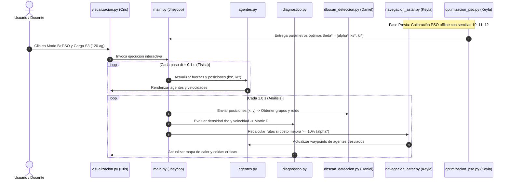

# Plan de Trabajo y Reparto de Tareas — Equipo de Desarrollo (Código)
**Proyecto:** Simulación de Multitudes y Optimización de Flujo en Entornos Interactivos  
**Materia:** Inteligencia Artificial — Universidad Mayor de San Simón (UMSS)  
**Docente:** Lic. Patricia Rodríguez Bilbao  
**Grupo:** 13  
**Versión:** 3.0 (Entrega Final)

---

## 1. Contexto y Objetivos de la Entrega Final (Versión 3)

El proyecto se encuentra en su fase final de consolidación y perfeccionamiento. Contamos con una base sólida de 8 módulos funcionales y una suite de pruebas que pasa al 100 %. Sin embargo, para la entrega y defensa final ante la docente **Lic. Patricia Rodríguez Bilbao**, se han identificado **cuatro mejoras técnicas prioritarias (Versión 3)** que deben implementarse de manera coordinada.

> **Importante para la Defensa Oral:**  
> Aunque cada integrante tiene un módulo y responsabilidades asignadas de forma equitativa, **todos los integrantes deben conocer en profundidad la arquitectura completa y el funcionamiento integral del código**. La docente puede realizar preguntas directas sobre cualquier etapa del sistema (física de agentes, detección no supervisada, diagnóstico de congestión, planificación adaptativa u optimización metaheurística).

---

## 2. Las Cuatro Grandes Mejoras Técnicas (Versión 3)

1. **Interfaz Gráfica Interactiva con Controles en Pantalla (sin flags CLI obligatorios):**  
   Migrar el control del simulador desde la consola de comandos hacia una interfaz gráfica intuitiva con botones, selectores y controles interactivos en tiempo real dentro de la ventana de simulación (`pygame-ce`).
2. **Calibración y Optimización Real con PSO:**  
   Conectar el optimizador por enjambre de partículas (`optimizacion_pso.py`) al bucle de simulación real mediante semillas de entrenamiento independientes (`10, 11, 12`) para calibrar el vector de parámetros $\theta = [\alpha, k_s, k_r]$, resolviendo el estancamiento observado en el escenario S3 (120 agentes, semilla 43).
3. **Optimización y Refinamiento de DBSCAN:**  
   Optimizar el rendimiento computacional de la detección no supervisada, clasificar explícitamente puntos núcleo (*core*), frontera (*border*) y ruido (*noise*), y calcular las métricas de calidad interna (Silhouette Score y Davies-Bouldin) sin provocar micro-congelamientos en la visualización.
4. **Pipeline Experimental y Automatización de Pruebas:**  
   Actualizar el flujo de experimentos y pruebas para evaluar y comparar sistemáticamente la terna: **Modo A (ruta fija)** vs. **Modo B (adaptativo base)** vs. **Modo B + PSO (calibrado)** a lo largo de los 18 escenarios oficiales (semillas de prueba `42, 43, 44`).

---

## 3. Reparto Equitativo de Tareas de Programación

```
+-----------------------------------------------------------------------------+
|                            EQUIPO DE DESARROLLO                             |
+------------------------+----------------------------------------------------+
| Integrante             | Área y Módulo Principal                            |
+------------------------+----------------------------------------------------+
| Cristhian Alba Zapata  | Controles por Interfaz (UI) y Motor del Entorno    |
| Keyla Y. Orellana C.   | Calibración PSO y Navegación Adaptativa A*         |
| Daniel T. Flores M.    | Optimización de DBSCAN y Métricas de Agrupamiento  |
| Alexander J. Padilla   | Pipeline de Integración, Pruebas y Experimentos V3 |
+------------------------+----------------------------------------------------+
```

---

### Integrante 1: Cristhian Alba Zapata ("Cris")
* **Área principal:** Controles por Interfaz Gráfica (UI) y Entorno del Sistema.
* **Archivos asignados:** `modulos/visualizacion.py`, `modulos/entorno.py`, `demos/demo_visualizacion.py`.

#### Tareas Técnicas Específicas:
1. **Desarrollar el Panel de Controles Gráficos en Pantalla:**
   * Diseñar e integrar una barra lateral o panel superior interactivo en `modulos/visualizacion.py` utilizando `pygame-ce` que evite tener que escribir flags en la terminal (`--modo B --agentes 120`).
   * **Selector de Modo:** Botones clicables para seleccionar: `Modo A` (Ruta fija), `Modo B` (Adaptativo base) y `Modo B + PSO` (Parámetros optimizados).
   * **Selector de Escenario:** Botones directos para la carga de población: `S1 (40 ag)`, `S2 (80 ag)` y `S3 (120 ag)`.
   * **Controles de Reproducción:** Botones de `Iniciar`, `Pausa`, `Paso a Paso` y `Reiniciar`.
   * **Toggles de Información (Capas Visuales):** Botones en pantalla para alternar:
     * Mapa de calor de densidad (tecla `H` o botón `[Calor: ON/OFF]`).
     * Clústeres detectados por DBSCAN (tecla `C` o botón `[Grupos: ON/OFF]`).
     * Trayectorias / Waypoints de los agentes (tecla `R` o botón `[Rutas: ON/OFF]`).
     * Captura instantánea de pantalla a PNG (tecla `S` o botón `[Capturar]`).
2. **Revisión y Robustez del Entorno (`modulos/entorno.py`):**
   * Verificar la consistencia de coordenadas: origen $(0,0)$ en la esquina inferior izquierda, dimensiones físicas en metros ($30{,}0 \times 20{,}0\text{ m}$), paso principal de $2{,}0\text{ m}$ y ruta alternativa de $3{,}0\text{ m}$.
   * Garantizar que la consulta `es_transitable(x, y)` mantenga tiempo de respuesta $O(1)$ sin asignaciones de memoria redundantes en cada ciclo de renderizado.

#### Preguntas Clave para la Defensa Oral:
* *¿Cómo se mapea el sistema de coordenadas de la física (metros con origen abajo-izquierda) a los píxeles de la ventana de Pygame (origen arriba-izquierda)?*
* *¿Por qué el paso principal tiene 2 m y la ruta alternativa 3 m, y cómo influye esa diferencia geométrica en la capacidad de flujo?*

---

### Integrante 2: Keyla Yhajaira Orellana Castro ("Keyla")
* **Área principal:** Navegación Adaptativa $A^*$ y Optimización por Enjambre de Partículas (PSO).
* **Archivos asignados:** `modulos/optimizacion_pso.py`, `modulos/navegacion_astar.py`, `scripts_analisis/calibrar_pso.py`, `pruebas/pruebas_navegacion.py`.

#### Tareas Técnicas Específicas:
1. **Conectar PSO a Episodios Reales del Simulador:**
   * Crear el script de calibración `scripts_analisis/calibrar_pso.py` que importe `pso` y `costo_J` desde `modulos.optimizacion_pso`.
   * Definir la función de aptitud `evaluar(theta)` que reciba el vector continuo $\theta = [\alpha, k_s, k_r]$ y ejecute la simulación completa sin interfaz gráfica (modo headless) sobre semillas de entrenamiento independientes (`10, 11, 12`) para los escenarios S2 y S3.
   * Respetar los límites físicos establecidos:
     $$\alpha \in [0{,}0; 5{,}0], \quad k_s \in [0{,}5; 2{,}0], \quad k_r \in [0{,}5; 3{,}0]$$
     manteniendo fijo el intervalo anti-oscilación $\tau = 4{,}0\text{ s}$ y margen de mejora del $10\%$.
2. **Exportar Resultados de Calibración:**
   * Guardar el historial de evolución de la mejor partícula ($J$ por iteración) y exportar el gráfico de convergencia a `capturas/convergencia_pso.png`.
   * Guardar el vector óptimo resultante $\theta^* = [\alpha^*, k_s^*, k_r^*]$ en `capturas/theta_optimo.json`.
3. **Validación del Cuello de Botella en S3 Semilla 43:**
   * Ejecutar el escenario crítico S3 (120 agentes) con semilla 43 bajo el Modo B + PSO.
   * Comprobar cuantitativamente que la tasa de finalización aumente desde el 59,2 % inicial (71/120) hacia el 100 % (120/120), reduciendo drásticamente el tiempo de espera por bloqueo.

#### Preguntas Clave para la Defensa Oral:
* *¿Por qué la heurística euclidiana en $A^*$ sigue siendo admisible y consistente incluso cuando se añade la penalización $\alpha \cdot D$?*
* *¿Cuál es el significado físico de cada componente de la función de costo $J(\theta)$ y por qué se usaron semillas distintas para entrenar y evaluar?*

---

### Integrante 3: Daniel Teodoro Flores Mamani ("Daniel")
* **Área principal:** Aprendizaje No Supervisado con DBSCAN y Métricas de Calidad.
* **Archivos asignados:** `modulos/dbscan_deteccion.py`, `scripts_analisis/calibrar_dbscan.py`, `scripts_analisis/figuras_dbscan.py`.

#### Tareas Técnicas Específicas:
1. **Optimización Computacional de DBSCAN:**
   * Asegurar que el llamado periódico a `DBSCAN(eps=1.2, min_samples=5)` sobre la matriz de posiciones $(N_{\text{activos}}, 2)$ se ejecute en $< 2\text{ ms}$, evitando cualquier caída en la tasa de refresco (60 FPS).
   * Utilizar la estructura interna de `scikit-learn` (`algorithm='kd_tree'` o `'ball_tree'`) para acelerar la búsqueda de vecinos dentro del radio $\varepsilon = 1{,}2\text{ m}$.
2. **Clasificación Estricta de Instancias:**
   * Separar con precisión y reportar en los diccionarios de clústeres:
     * **Puntos Núcleo (Core):** Agentes con al menos $\text{MinPts} = 5$ vecinos en su radio $\varepsilon$.
     * **Puntos Frontera (Border):** Agentes alcanzables por densidad pero con menos de $\text{MinPts}$ vecinos propios.
     * **Puntos de Ruido (Noise/Outliers):** Agentes etiquetados con `-1` que circulan de manera aislada.
3. **Cálculo de Métricas de Agrupamiento y Regeneración de Figuras:**
   * Automatizar el cálculo de los índices Silhouette y Davies-Bouldin exclusivamente cuando existan $\ge 2$ grupos válidos (excluyendo el ruido).
   * Actualizar y ejecutar `scripts_analisis/figuras_dbscan.py` para generar las figuras analíticas finales en alta resolución: distribución espacial de clústeres en S3, efecto de variar $\varepsilon$ y evolución temporal de grupos.

#### Preguntas Clave para la Defensa Oral:
* *¿Por qué se seleccionó DBSCAN en lugar de K-Means para la detección de aglomeraciones en este proyecto?*
* *¿Qué representa biológicamente un punto de ruido versus un punto núcleo en una multitud que avanza hacia un paso estrecho?*

---

### Integrante 4: Alexander J. Padilla ("Jheycob")
* **Área principal:** Integración del Sistema, Batería de Pruebas y Experimentos V3.
* **Archivos asignados:** `main.py`, `pruebas/ejecutar_todas.py`, `pruebas/pruebas_integracion.py`, `demos/demo_final.py`.

#### Tareas Técnicas Específicas:
1. **Integración Global en `main.py`:**
   * Extender `ejecutar_episodio()` en `main.py` para admitir de forma limpia el vector de parámetros calibrados $\theta = [\alpha, k_s, k_r]$.
   * Permitir la ejecución fluida del nuevo Modo `B_PSO` en la comparativa global sin romper la compatibilidad con los Modos `A` y `B` originales.
2. **Automatización de los 18 Escenarios Experimentales:**
   * Implementar la rutina experimental ampliada que corra los 18 escenarios de prueba oficiales (semillas `42, 43, 44` para S1, S2, S3) bajo los tres modos: A, B y B+PSO.
   * Exportar la tabla consolidada `capturas/tabla_comparativa_v3.csv` con promedios y desviaciones estándar de: tiempo de tránsito, tiempo de espera, tasa de finalización, solapamientos, celdas críticas máximas y cambios de ruta.
3. **Mantenimiento y Cobertura de Pruebas Unitarias:**
   * Asegurar que el script `pruebas/ejecutar_todas.py` siga reportando **100 % de éxito** tras las modificaciones.
   * Añadir casos de prueba en `pruebas/pruebas_integracion.py` que verifiquen el correcto paso de parámetros de PSO y el funcionamiento de la nueva interfaz gráfica interactiva.
   * Diseñar un script lanzador de un solo paso `demos/demo_final.py` listo para la presentación en vivo ante la docente.

#### Preguntas Clave para la Defensa Oral:
* *¿Cómo se coordina el desacoplamiento temporal entre el paso de física ($\Delta t = 0{,}1\text{ s}$) y el paso de análisis y diagnóstico ($1{,}0\text{ s}$)?*
* *¿Cómo se calcula el tiempo de espera por bloqueo individual y cuándo se considera que un agente está congestionado?*

---

## 4. Matriz de Dependencias y Puntos de Integración



### 4.1. Explicación Narrativa del Flujo de Ejecución

1. **Fase Previa (Calibración Offline con PSO - Keyla):**
   * Antes de la ejecución interactiva, el algoritmo PSO corre por lotes evaluando episodios de simulación sobre semillas de entrenamiento (`10, 11, 12`).
   * Optimiza el vector de parámetros $\theta = [\alpha, k_s, k_r]$ y entrega los pesos óptimos $\theta^*$ al sistema principal.
2. **Inicio y Control por Interfaz (Cris y Jheycob):**
   * El usuario o la docente interactúa con los controles gráficos en pantalla (`visualizacion.py`): selecciona el Modo (ej. `Modo B + PSO`) y la cantidad de agentes (ej. `S3 = 120 agentes`).
   * La interfaz gráfica comunica la configuración a `main.py` para instanciar el entorno y generar los agentes en la zona de entrada.
3. **Bucle de Física en Tiempo Real — Cada $\Delta t = 0{,}1\text{ s}$ (10 Hz):**
   * `main.py` invoca la actualización del motor de agentes (`agentes.py`).
   * Cada agente calcula su vector de fuerzas sociales resultante: atracción al siguiente waypoint ($\vec{F}_o$), separación entre peatones con constante calibrada $k_s^*$ ($\vec{F}_s$) y repulsión de paredes y obstáculos con constante $k_r^*$ ($\vec{F}_r$).
   * Se resuelven colisiones inelásticas continuas y se actualizan velocidades y posiciones sin solapamientos.
   * `visualizacion.py` recibe las posiciones actualizadas y dibuja los agentes con su color correspondiente (verde si fluyen hacia rojo si están casi detenidos).
4. **Bucle de Análisis, Diagnóstico y Adaptación — Cada $1{,}0\text{ s}$ (1 Hz / cada 10 ticks):**
   * **Telemetría:** Extrae la matriz cruda de posiciones bidimensionales $(N_{\text{activos}}, 2)$ sin información previa de clases ni etiquetas.
   * **Detección con DBSCAN (Daniel):** Procesa las posiciones con $\varepsilon = 1{,}2\text{ m}$ y $\text{MinPts} = 5$, identificando grupos espaciales densos, puntos núcleo, puntos frontera y agentes aislados (ruido con etiqueta `-1`).
   * **Diagnóstico de Congestión (Lora):** Cuantifica la densidad $\rho$ en la grilla de celdas de $2 \times 2\text{ m}$. Si $\rho \ge 2{,}0\text{ ag/m}^2$ y la rapidez media cae a $\le 50\%$ durante al menos 3 segundos consecutivos, declara estado de **congestión crítica** y genera la matriz normalizada de penalización $D \in [0, 1]$.
   * **Navegación Adaptativa $A^*$ (Keyla):** Si el modo es `B`, evalúa el costo $c(e, t) = L(e)[1 + \alpha^* D(e, t)]$. Si un agente lleva al menos $\tau = 4{,}0\text{ s}$ sin recalcular y la ruta alternativa mejora el costo en al menos un $10\%$, se actualiza su lista de waypoints en `agente.ruta` hacia el paso inferior de 3 m.
   * **Retroalimentación Visual (Cris):** Se actualiza el mapa de calor superpuesto en la interfaz y el panel de telemetría (celdas críticas activas, agentes llegados y tiempo transcurrido).

---

### 4.2. Tabla de Puntos de Integración y Contratos de Datos

| Paso | Frecuencia / Momento | Módulo Emisor | Módulo Receptor | Datos Transmitidos (Contrato de Interfaz) | Responsable |
| :---: | :---: | :---: | :---: | :---: | :---: |
| **1** | Pre-ejecución (Offline) | `optimizacion_pso.py` | `main.py` / `navegacion_astar.py` | Vector óptimo $\theta^* = [\alpha^*, k_s^*, k_r^*]$ en formato JSON o tupla NumPy. | **Keyla** |
| **2** | Al interactuar | `visualizacion.py` (Panel UI) | `main.py` | Eventos de clic de botones: `modo` ('A', 'B', 'B_PSO'), `n_agentes` (40, 80, 120), `estado` (Play/Pausa/Reset). | **Cris** |
| **3** | Cada $\Delta t = 0{,}1\text{ s}$ | `main.py` | `agentes.py` (`MotorAgentes`) | Llamada a `motor.actualizar(dt=0.1)` aplicando fuerzas con $k_s^*$ y $k_r^*$. | **Jheycob** |
| **4** | Cada $\Delta t = 0{,}1\text{ s}$ | `agentes.py` (`MotorAgentes`) | `visualizacion.py` (`Visualizacion`) | Lista de `Agente` activos con atributos `(x, y, vx, vy, v_deseada)` para renderizado. | **Cris** |
| **5** | Cada $1{,}0\text{ s}$ (10 ticks) | `telemetria.py` | `dbscan_deteccion.py` | Arreglo NumPy `(N_activos, 2)` con coordenadas $[x, y]$ en metros de agentes activos. | **Daniel** |
| **6** | Cada $1{,}0\text{ s}$ (10 ticks) | `telemetria.py` | `diagnostico.py` | Posiciones y velocidades de agentes activos para evaluar densidad $\rho$ y rapidez media. | **Santy** *(Doc)* |
| **7** | Cada $1{,}0\text{ s}$ (10 ticks) | `diagnostico.py` | `navegacion_astar.py` | Matriz $D$ de forma `(10, 15)` con flotantes en $[0{,}0; 1{,}0]$ discretizada a celdas de $2 \times 2\text{ m}$. | **Keyla** |
| **8** | Cada $1{,}0\text{ s}$ (10 ticks) | `navegacion_astar.py` | `agentes.py` (`Agente.ruta`) | Reemplazo de la lista de waypoints `[(x, y), ...]` en metros si mejora $\ge 10\%$ y $\Delta t \ge 4{,}0\text{ s}$. | **Keyla** |
| **9** | Cada $1{,}0\text{ s}$ (10 ticks) | `diagnostico.py` / `telemetria.py` | `visualizacion.py` | Matriz de densidad para mapa de calor y contadores numéricos (activos, llegados, celdas críticas). | **Cris** |

---

## 5. Reglas de Trabajo para el Equipo de Código

1. **Inmutabilidad de Contratos:** No modificar los nombres de atributos ni las firmas de métodos públicos en `Entorno`, `Agente`, `DiagnosticoCongestion`, `NavegadorAdaptativo` ni `Telemetria`. Cualquier cambio debe ser retrocompatible.
2. **Cero Dependencias Externas Nuevas:** Solo se permite el uso del entorno oficial (`python`, `numpy`, `scikit-learn`, `pygame-ce`, `matplotlib`).
3. **Validación Continua:** Antes de subir cualquier cambio al repositorio, ejecutar obligatoriamente:
   ```bash
   python pruebas/ejecutar_todas.py
   ```
   Ningún cambio se considera terminado si no pasan los 10 scripts de pruebas.

---

## 6. Cronograma Crítico de Entregas por Horas y Dependencias (Sábado 21 y Domingo 22)

Para garantizar que el código esté 100 % integrado y operativo el **domingo a media mañana** (permitiendo que la tarde del domingo se dedique íntegramente a revisión cruzada, simulacro de preguntas y preparación de la defensa), se establece la siguiente secuencia de desbloqueo temporal:

```
+---------------------------------------------------------------------------------------------------------+
| SECUENCIA DE DESBLOQUEO TEMPORAL (CÓDIGO)                                                               |
+------------------------------------+--------------------------------------------------------------------+
| Sábado 21, 14:00 (Hito C1)         | Keyla entrega theta* y convergencia PSO. Desbloquea a Jheycob.     |
| Sábado 21, 14:30 (Hito C2)         | Daniel entrega DBSCAN optimizado y figuras. Desbloquea a Wendy/Doc.|
| Sábado 21, 16:30 (Hito C3)         | Cris entrega controles UI interactivos. Desbloquea a Jheycob y Doc.|
| Sábado 21, 20:00 (Hito C4)         | Jheycob corre experimentos A vs B vs B+PSO. Desbloquea informe V.  |
| Domingo 22, 09:30 (Hito C5)        | Suite de pruebas al 100% y demo_final.py lista.                    |
| Domingo 22, 14:00–18:00            | REVISIÓN GENERAL Y SIMULACRO DE DEFENSA CON LOS 8 INTEGRANTES.     |
+------------------------------------+--------------------------------------------------------------------+
```

### Detalle de Hitos por Integrante y Dependencia:

| Hito | Fecha y Hora Límite | Integrante | Entregable Concreto | Dependencia / A Quién Desbloquea |
| :---: | :---: | :---: | :---: | :---: |
| **C1** | **Sábado 21 — 14:00** | **Keyla** | • Script `scripts_analisis/calibrar_pso.py`<br>• Archivo `capturas/theta_optimo.json`<br>• Gráfica `capturas/convergencia_pso.png` | **Entrega a Jheycob:** Le permite alimentar `main.py` con $\theta^* = [\alpha^*, k_s^*, k_r^*]$ para correr los experimentos calibrados. También entrega las gráficas al equipo de Documentación (Nicole). |
| **C2** | **Sábado 21 — 14:30** | **Daniel** | • Módulo `dbscan_deteccion.py` optimizado ($< 2\text{ ms}$ por tick de análisis)<br>• Clasificación core/border/noise verificada<br>• Figuras analíticas en `capturas/fig_*.png` | **Entrega al Equipo de Documentación:** Desbloquea la redacción y figuras de la subsección 5.4. |
| **C3** | **Sábado 21 — 16:30** | **Cris** | • Panel de control interactivo en pantalla en `modulos/visualizacion.py` con botones de Modos (A, B, B+PSO), Población (S1, S2, S3), Play/Pausa/Reset y Toggles visuales. | **Entrega a Jheycob y Wendy:** Jheycob lo integra en el lanzador interactivo y Wendy extrae las capturas de la nueva UI para la subsección 5.2. |
| **C4** | **Sábado 21 — 20:00** | **Jheycob** | • Batería de 18 escenarios ejecutada (Modo A vs. Modo B vs. Modo B+PSO)<br>• `capturas/tabla_comparativa_v3.csv`<br>• Gráfico `capturas/comparacion_experimental_A_vs_B.png` actualizado con la terna. | **Entrega al Equipo de Documentación (Nicole):** Desbloquea la subsección 5.9 (Resultados) y las Conclusiones finales. |
| **C5** | **Domingo 22 — 09:30** | **Jheycob y Cris** | • `python pruebas/ejecutar_todas.py` pasando al 100 % (10/10 scripts)<br>• Script de demostración `demos/demo_final.py` funcional con 1 clic. | **Cierre Técnico:** Deja el software listo y congelado para que todo el equipo lo pruebe el domingo por la tarde. |
